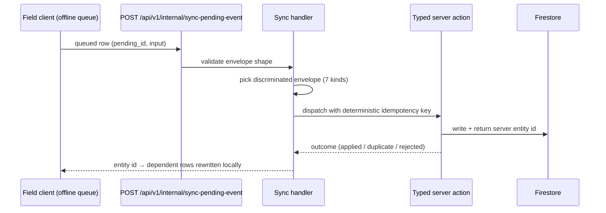
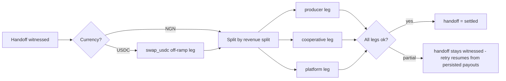
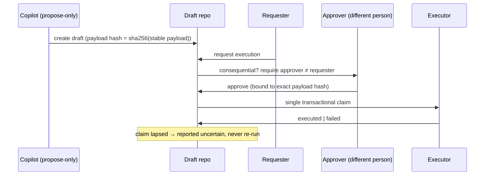

# Architecture

A tour of the first-party `lib/` packages and the four data flows that define the system.
Paths refer to the production repository; this showcase reproduces only the abridged excerpts
under `highlights/`.

## First-party package tour

| Package | What it owns |
|---|---|
| `lib/actions/` | Zod-validated server-action boundaries — every mutation enters here |
| `lib/ai/agents/` | The copilot core: propose-only envelope, cost guard, per-role principals, tool registry |
| `lib/rag/` | Retrieval layer, daily cost caps, eval harness, citation discipline |
| `lib/analytics/` | Source-rating and access-guard internals (security surface — described, not reproduced) |
| `lib/auth/` | Sessions and authorization primitives (`requirePerson`, `requireStateAdmin`, `roleSatisfies`) |
| `lib/cluster-os/` | Cluster ventures and the **pure** cycle-settlement waterfall (no I/O) |
| `lib/command-center/` | Precomputed national/corridor logistics aggregates for the wall instruments |
| `lib/db/` | Firestore data layer: typed repos, schemas, collection constants |
| `lib/estates/` | Estate subscriptions, entitlements, and access resolution |
| `lib/handoffs/` | Two-party custody handoffs and the payment settlement orchestrator |
| `lib/integrations/payments/` | Rail adapters (Paystack, Bitnob), mock-mode discipline, rails-health snapshot |
| `lib/jobs/` | Reconciliation and scheduled-job state |
| `lib/mrv/` | Carbon MRV: operating profiles → event-level tCO2e evidence lines |
| `lib/operator-org/` | The organisation OS: policy, 47 modules, 90+ action catalog, agent drafts, autonomy envelopes |
| `lib/operator-org/intelligence/` | 11 domain readers over the same rows the copilot sees |
| `lib/operator-org/monitoring/` | 19 detector rules → durable, dedupe-keyed findings with escalation |
| `lib/organization/` | Legal entity kinds, per-kind KYC document requirements, verification transitions |
| `lib/plots/` | Plot geometry and boundary fingerprints (hash-stable boundary identity) |
| `lib/scoring/` | Scoring models with their own eval runner |
| `lib/storage/` | Evidence storage: tenant-scoped paths and upload-URL minting |
| `lib/voice/` | Voice-mode shared contracts (locales, SSE event union, voice cards) — described only |

## Data flow A — offline field sync

Field work happens where connectivity does not. The Android/web clients queue every mutation
locally (service worker or in-page coordinator) and drain the queue against one endpoint.

What makes it more than a queue:

- **Six discriminated envelope kinds** (cluster-plan actuals, farm-task completions, watch
  inspections, plot boundary captures, estate chain events, smallholder enrolments) fan out to
  **ten typed server-action surfaces** — plots, boundaries, harvest lots, dispatch/intake,
  workbench operations, enumeration.
- **Deterministic idempotency keys** mean a retried sync can never double-apply.
- **Boundary fingerprints** give plot geometry hash-stable identity, so a boundary re-capture and
  its evidence stay linked.
- **Evidence uploads** are minted as storage URLs inside the same envelope, so a task completion
  and its photo land atomically from the client's point of view.

Excerpted in [highlights/04-offline-sync.md](highlights/04-offline-sync.md).

## Data flow B — settlement

Two distinct money events, deliberately kept apart:

1. **Handoff settlement** (`lib/handoffs/pay-settlement.ts`) splits the proceeds of *one delivery*
   across legs. NGN legs route directly; USDC legs first off-ramp through a swap-staging leg, then
   split. Every leg carries an idempotency key derived from the handoff id and leg name; a rerun
   resumes from persisted payouts instead of re-invoking a rail. The producer leg gates the
   transition to `settled` — cooperative and platform legs may lag without holding producer funds.
2. **Cycle settlement** (`lib/cluster-os/cycle-settlement.ts`) closes a whole production cycle as a
   *pure* function: gross revenue − platform fee − operating cost − financier recovery (senior) =
   distributable residual → operator profit share and vested equity → remainder to the sponsor.

Rail state is never guessed: an env-presence snapshot (`lib/integrations/payments/rails-health.ts`)
classifies each rail `live / mock / missing / misconfigured`, and money **fails closed** — a mock
flag in production makes payment paths throw rather than simulate success.

Excerpted in [highlights/01-settlement-engine.md](highlights/01-settlement-engine.md).

## Data flow C — evidence and four-eyes approval

The AI copilot runs inside a **propose-only envelope**: cost cap, rate limit, and every tool result
routed through an audit hook. When the copilot proposes a consequential action, the proposal becomes
a durable draft, not a side effect:

1. The draft stores the **SHA-256 of a stable stringification** of the exact payload — an approval
   recorded against one payload can never authorise a different one.
2. Executing a draft takes a **single transactional claim**: a finished draft cannot be re-executed,
   and a claimed-but-crashed draft stays `executing` until the claim lapses — then it is reported
   `uncertain` and **never silently re-run**.
3. **Consequential** actions (payments, settlements, recalls, carbon finalisation,…) demand a second,
   *different* person to approve — four eyes, approver ≠ requester.
4. The **action catalog is the single source of truth**: each of the 90+ actions carries its risk
   class and autonomy lane; unknown action ids resolve to the most restrictive lane, so the
   auto-decider can never execute what the catalog does not know.

Excerpted in [highlights/02-evidence-and-four-eyes.md](highlights/02-evidence-and-four-eyes.md).

## Data flow D — satellite layer serving

Estate satellite overlays are served, not fabricated:

- **Entitlement-gated**: any live trial or paid tier unlocks the satellite module; organisation
  membership never bypasses an estate subscription.
- **Tenant-scoped**: rendered PNGs live under `tenant-<plan>` storage paths — never public static
  assets; a plan's plot-union bounds drive the render, and the bbox is cached with the overlay doc
  so repeated requests never re-walk plots.
- **Honest degradation**: if the render environment is unavailable, the route answers `503` with a
  *named gap* — never a fabricated overlay.

Excerpted in [highlights/05-satellite-layers.md](highlights/05-satellite-layers.md).

## Cross-cutting invariants

- **Money fails closed.** Mock payments are forbidden in production; rails health is reported from
  env presence, never from secret values.
- **Evidence is structural, not ceremonial.** Production actuals must be events recorded by the
  worker's own identity within the same org and plan — verified in code, not policy docs.
- **Consent replaces, never unions.** Re-consent overwrites exactly the selection the farmer
  reviewed; revocation is honored on read.
- **Every excerpt in this showcase is abridged and attributed.** The production repository is private.
