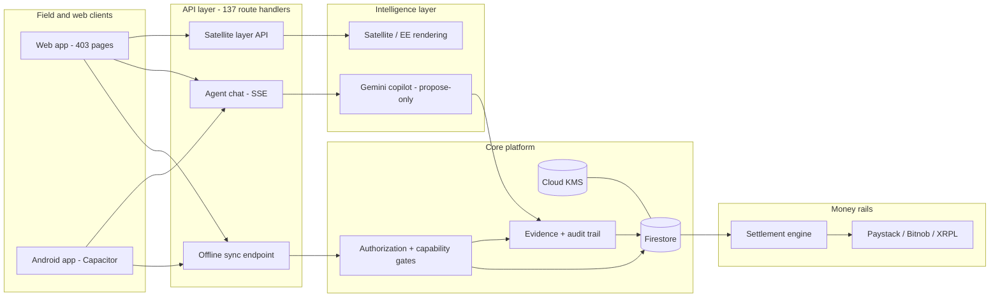

# AgriPay — the operating system for agricultural organisations

> **Run the whole operation. Keep every proof.**
>
> **See** — satellite + AI sense the estate · **Run** — 90+ governed actions, 10 org roles ·
> **Prove** — evidence-bound tasks, consent, four-eyes, audit trails ·
> **Pay** — settlement, payroll, subscriptions, lender/insurer mandates

## What this is

AgriPay is a multi-tenant operating system for agricultural organisations. One system fuses five
layers over real farmland: a **system of record** (land, blocks, work orders, stock, equipment,
custody, money), a **system of action** (90+ catalogued actions executed under a typed role
capability matrix), a **system of intelligence** (11 domain readers, 19 detectors, satellite
observation, and an AI copilot that proposes actions as durable drafts), a **system of
verification** (evidence-bound execution, farmer consent grants, four-eyes controls, payload-hash
binding, audit trails), and a **system of value** (cycle close, waterfall settlement, labour pay,
invoices, subscriptions, lender/insurer mandates). Satellite imagery and generative AI are the
sensory and cognitive layer of that OS — not its identity.

For engineers, this repository showcases the parts of that system that are hardest to build:
a dual-currency settlement engine with per-leg idempotency and resumable partial success; an
offline-first sync endpoint that fans one queued envelope out to ten typed server-action surfaces;
an AI copilot that can *propose* consequential actions but can never *decide* them — approvals are
cryptographically bound to the exact payload hash, executed under a single transactional claim, and
reported `uncertain` rather than silently re-run when a claim lapses; and tenant-scoped satellite
raster serving that degrades to a named gap instead of fabricating data. Everything here is
TypeScript end to end, Zod-validated at every boundary, and backed by a verification culture of
1,110 test files and CI-enforced citation checks.

## Verified by code

| Metric | Value |
|---|---|
| TypeScript source (`app/`, `lib/`, `components/`, `hooks/`) | ~795,000 lines across 3,938 files |
| — of which test code | 203,000 lines across 1,110 test files |
| Application pages | 403 |
| API route handlers | 137 |
| Playwright e2e specs | 26 |
| Public marketing routes / protected route prefixes | 17 / 21 |
| Operator modules (three operating modes) | 47 |
| Catalogued executable actions | 90+ |
| Org roles under a typed capability matrix | 10 |
| Proactive intelligence domains | 11 |
| Detector rule codes | 19 |
| AI autonomy lanes (auto_routine → human_consequential) | 4 |

## Tech stack

- **Framework:** Next.js 15 (App Router, Turbopack) + React 19 + TypeScript 5.7, Tailwind CSS
- **Data:** Firebase (Firestore + Storage) with firebase-admin, Cloud KMS, Zod schemas at every boundary
- **AI:** Gemini via `@google/genai`, first-party RAG layer, agent framework with propose-only envelopes and cost guards
- **Geospatial:** MapLibre GL, Mapbox draw, Turf geometry suite, PMTiles, GeoTIFF, satellite.js
- **Money:** Paystack + Bitnob rails, XRPL, fail-closed mock-mode discipline
- **Mobile:** Capacitor 8 (Android + iOS), 13 native plugins (camera, geolocation, push, network, filesystem)
- **3D & viz:** three.js + React Three Fiber, Recharts
- **IoT & i18n:** MQTT telemetry, next-intl (English, Yoruba, Hausa, Igbo)
- **Testing:** tsx --test unit suite, Firebase emulator rules tests, Playwright e2e, three AI eval harnesses

## Architecture at a glance

## Highlights

1. [Settlement engine](highlights/01-settlement-engine.md) — dual-currency, multi-leg, per-leg idempotency, resumable partial success, fail-closed rails health
2. [Evidence and four-eyes](highlights/02-evidence-and-four-eyes.md) — payload-hash-bound AI action drafts, replay-proof claims, consent model, 90+ action catalog
3. [AI copilot](highlights/03-ai-copilot.md) — SSE streaming with propose-only guardrails, cost caps, rate limits, audit
4. [Offline sync](highlights/04-offline-sync.md) — one envelope, ten typed surfaces, boundary fingerprints, evidence uploads
5. [Satellite layers](highlights/05-satellite-layers.md) — tenant-scoped, entitlement-gated raster serving with honest 503 degradation
6. [Testing and CI](highlights/06-testing-and-ci.md) — 1,110 test files, emulator rules tests, Playwright e2e, AI eval harnesses, citation rot-gate

---

*This is a curated showcase. The production repository is private. © 2026 Agcore Africa.*
